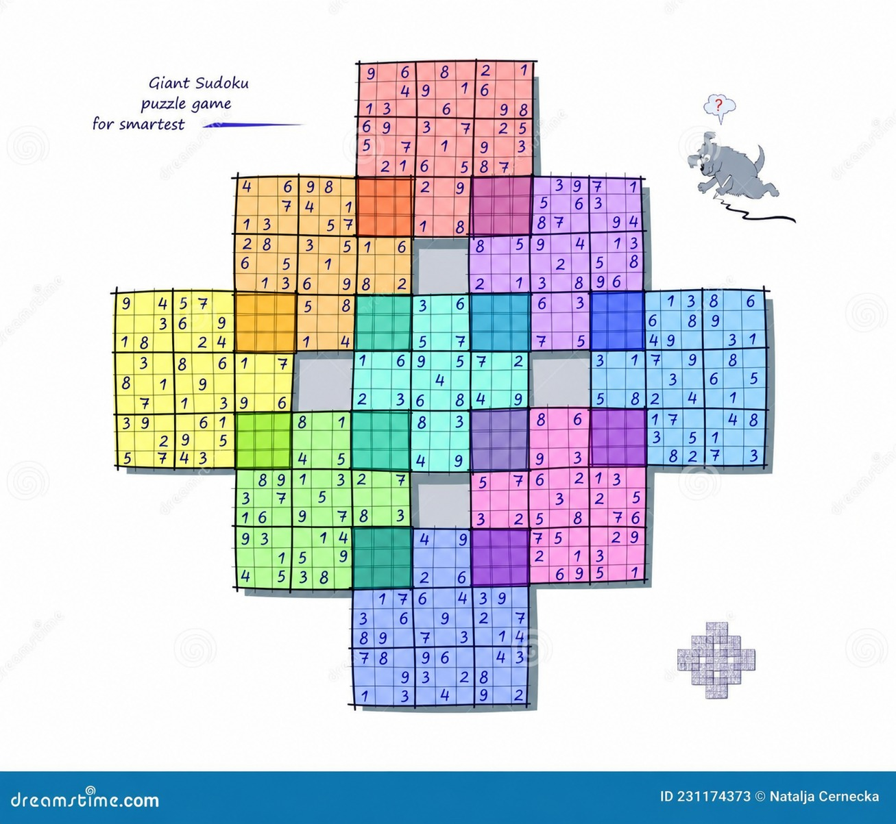

# 🧩 Sudoku Solver (Tradicional e Samurai)

Gerador e solucionador de Sudoku em Python puro, sem bibliotecas externas. Suporta o **Sudoku Tradicional NxN** (qualquer quadrado perfeito: 4, 9, 16…) e o **Sudoku Samurai (33x33)**. O foco é **comparar estratégias de resolução**: além de saber se o tabuleiro foi resolvido, mede o desempenho de cada algoritmo.

## 🚀 Como executar

O programa precisa ser executado **de dentro da pasta `Sudoku`**, porque os imports partem dela:

```bash
cd Sudoku
python main.py
```

Pelo menu interativo você escolhe:
1. o tipo de jogo (Tradicional ou Samurai);
2. o tamanho (só no tradicional; deve ser quadrado perfeito);
3. quantos jogos gerar;
4. a dificuldade;
5. o método de resolução (só no tradicional; o Samurai usa Backtracking automaticamente).

## ✨ Funcionalidades

### 🎮 Dois modos de jogo

* 🟩 **Sudoku Tradicional (NxN):** o clássico puzzle lógico, em qualquer tamanho que seja quadrado perfeito.
* 🟪 **Sudoku Samurai (33x33):** 9 tabuleiros 9x9 interconectados numa matriz global, com regiões de sobreposição e regras compartilhadas.



### 🎯 Níveis de dificuldade

A dificuldade define a fração de células que começam reveladas:

| Nível | Células reveladas |
|---|---|
| Fácil | 50% |
| Médio | 40% |
| Difícil | 30% |

### 🖥️ Visualização no terminal

Os tabuleiros são exibidos com cores ANSI: **cinza** para células vazias, **verde** para os números originais do puzzle e **azul** para os números preenchidos pelo algoritmo. O Samurai tem uma visualização própria para as regiões de sobreposição.

### 📊 Métricas e logs

Ao final de cada bateria são exibidos jogos resolvidos/impossíveis, quadrantes corretos, cobertura média, tentativas e tempo total. O resumo é acrescentado em `results.json` (uma chave `teste_N` por execução).

## 🧠 Métodos de resolução (Tradicional)

1. **🎲 Probabilidade com 1 tentativa**: preenche a célula com menos candidatos sorteando um número com peso inversamente proporcional a quantas células ele ainda poderia ocupar. Não volta atrás.
2. **🎲 Probabilidade com N tentativas**: repete o método anterior, restaurando o tabuleiro, até resolver ou atingir o limite de tentativas.
3. **🧠 Backtracking**: busca em profundidade (DFS) com a heurística MRV (célula com menos candidatos primeiro) e retrocesso ao encontrar conflito.

> ⚠️ O Sudoku Samurai usa sempre um **Backtracking adaptado**, que valida cada célula em todos os tabuleiros aos quais ela pertence.

A geração do puzzle também usa Backtracking: um tabuleiro completo é gerado com candidatos embaralhados e depois são removidos números até a quantidade da dificuldade.

## 🧩 Configuração do Samurai

As posições iniciais de cada tabuleiro 9x9 na matriz 33x33 ficam em `core/config.py`:

```python
SAMURAI_CONFIG = [
    ("SUDOKU_A", (0, 12)),
    ("SUDOKU_B", (6, 18)),
    ("SUDOKU_C", (6, 6)),
    ("SUDOKU_D", (12, 0)),
    ("SUDOKU_E", (12, 12)),
    ("SUDOKU_F", (12, 24)),
    ("SUDOKU_G", (18, 6)),
    ("SUDOKU_H", (18, 18)),
    ("SUDOKU_I", (24, 12)),
]
```

## 📁 Estrutura do projeto

```text
Sudoku/
├── main.py                     # menus, fluxo da bateria e métricas
├── core/
│   └── config.py               # posições dos tabuleiros do Samurai
└── src/
    ├── Board.py                # exibição e verificação de vitória
    ├── BoardGeneration.py      # validação, MRV, geração e remoção de números
    ├── gameConfig.py           # dificuldade → células reveladas
    ├── Probability.py          # resolvedores (probabilidade e Backtracking)
    ├── Logs.py                 # gravação do results.json
    └── SamuraiGame/
        ├── BoardSamuraiGeneration.py   # grade 33x33, validação global, geração e resolução
        └── SamuraiBoard.py             # exibição do Samurai
```

## 📌 Limitações conhecidas

- O status "resolvido" dos métodos probabilísticos ainda não reflete corretamente falhas de resolução.
- No Samurai, a porcentagem da dificuldade é aplicada sobre a matriz 33x33 inteira, e não só sobre as células jogáveis.
- O `results.json` ainda registra todos os jogos como 9x9 tradicionais.

Os detalhes estão na documentação.

## 📚 Documentação

A documentação completa do projeto está em [`vault/_Teste_AI.md`](../vault/_Teste_AI.md). Comece por esse arquivo para consultar a arquitetura, os algoritmos, as decisões técnicas, os problemas conhecidos e os próximos passos. Os detalhes deste subprojeto estão em [`vault/modulos/Sudoku/`](<../vault/modulos/Sudoku/!Modulo Sudoku.md>).

## 👨‍💻 Autor

**Eu**
